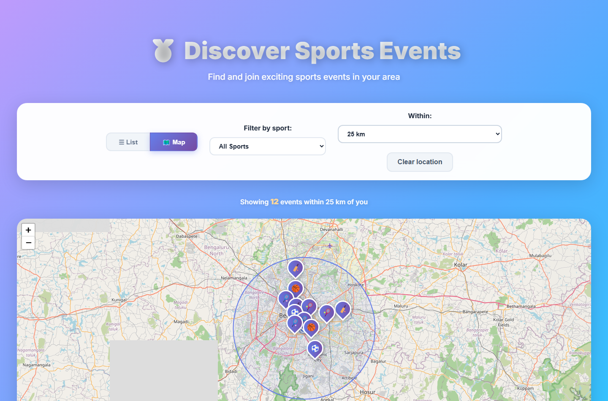
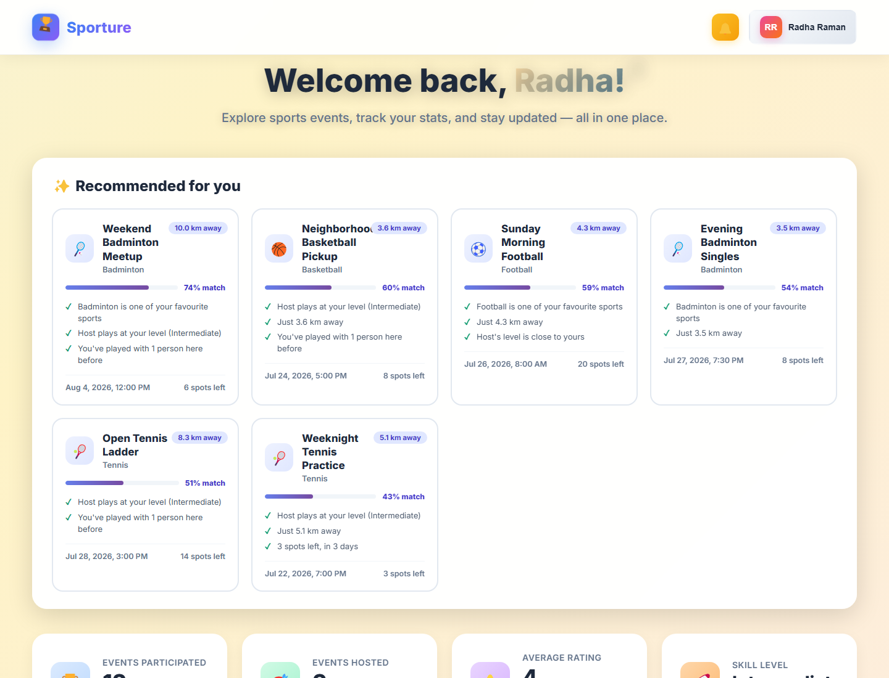
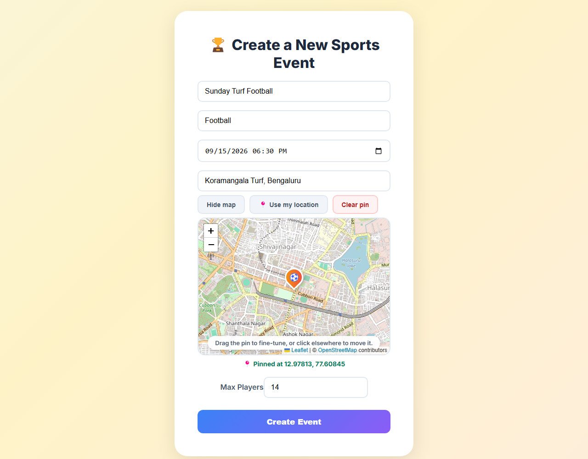
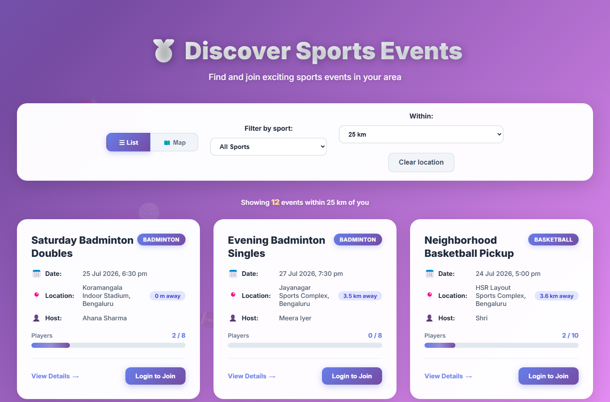
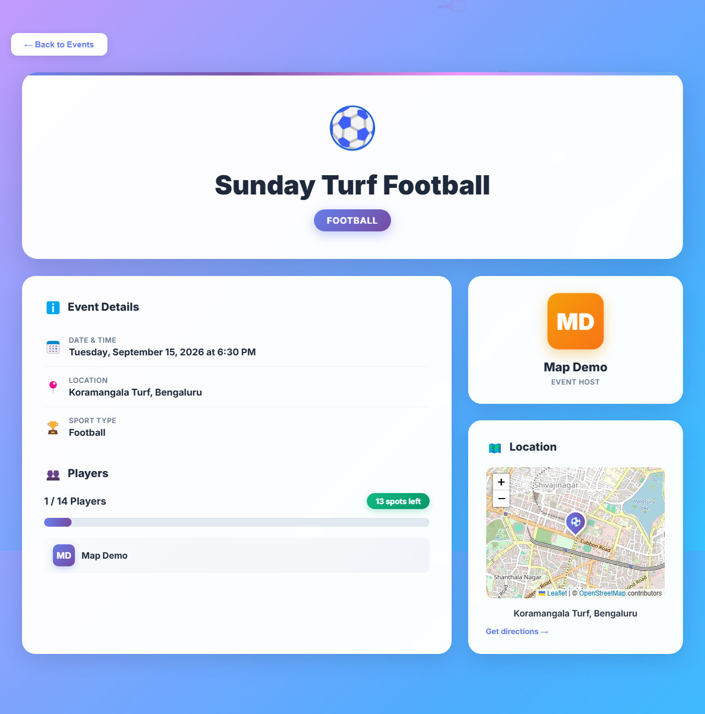
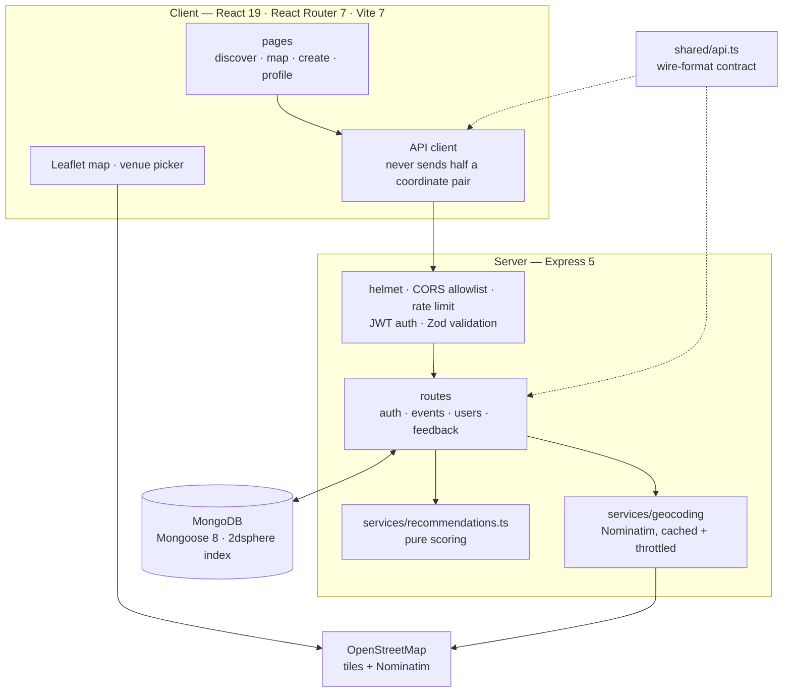
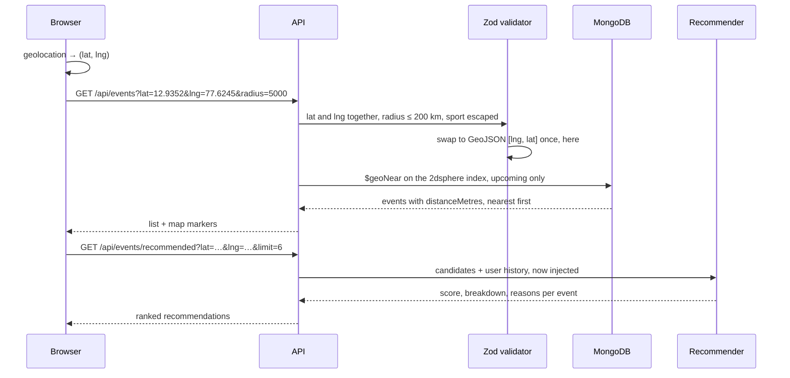

# Sporture

<p align="center">
  <a href="Sporture%20Demo.mp4">
    
  </a>
  <br>
  <sub>▶ <b><a href="Sporture%20Demo.mp4">Watch the Sporture demo</a></b> (74 s): the day-one plan, all 18 commits, the CI run, the README quick start on a fresh clone, and 12 live steps through the web app and the API</sub>
</p>

**Find and join local sports events near you — ranked by real distance from a MongoDB `2dsphere` index, then personalised per player.**

[](.github/workflows)
[](shared/api.ts)
[](Client/package.json)
[](Server/app.ts)
[](Server/models)
[](#what-ci-proves-on-every-push)
[](LICENSE)

A full-stack TypeScript app built around geospatial search. Players find events
within a radius of where they are, see them on a map, and get recommendations
that explain themselves; hosts create events at an exact venue; capacity holds
even when six people tap "join" at once.



---

## Contents

| Section | |
|---|---|
| [What it does](#what-it-does) | The feature surface, by area |
| [Architecture](#architecture) | SPA, API, shared contract, database |
| [How a search travels](#how-a-search-travels) | Coordinates in, ranked events out |
| [Quick start](#quick-start) | Docker and a seeded demo |
| [Project status](#project-status) | What ships, and what CI proves |
| [Design decisions](#design-decisions) | The tradeoffs, and why |
| [Reference](#reference) | API, search and recommendation parameters |
| [Repository layout](#repository-layout) | Where things live |
| [Team](#team) | Who built it |

---

## What it does

| Area | Capabilities |
|---|---|
| **Proximity search** | Events within an adjustable radius of browser geolocation, nearest-first, with the distance on every card |
| **Geocoding** | Server-side via OpenStreetMap Nominatim, with an in-process cache and throttling to respect its usage policy |
| **Recommendations** | Five weighted signals — sport affinity, proximity, skill match, shared history, urgency — and the reasons behind each score |
| **Maps** | List/map toggle, sport-aware markers, a radius circle, and a click-or-drag venue picker; Leaflet + OSM tiles, no API key |
| **Events** | Create, browse and join; capacity enforced atomically; past events rejected at creation and closed to joins |
| **Accounts** | JWT auth with bcrypt, editable profiles with avatar upload, feedback tied to the signed-in user |
| **Security** | Helmet, a CORS allowlist, rate limiting, Zod validation that doubles as a field allowlist |

<table>
  <tr>
    <td width="50%">
      
      <sub><b>Recommendations</b> — scored, and each one explains itself</sub>
    </td>
    <td width="50%">
      
      <sub><b>Venue picker</b> — drop or drag a pin for exact coordinates</sub>
    </td>
  </tr>
  <tr>
    <td width="50%">
      
      <sub><b>List view</b> — the same query, sorted nearest-first</sub>
    </td>
    <td width="50%">
      
      <sub><b>Event detail</b> — participants, capacity and directions</sub>
    </td>
  </tr>
</table>

---

## Architecture



---

## How a search travels



---

## Quick start

> Developing without Docker needs Node 20+ and MongoDB; see
> [Reference](#reference) for the environment.

```bash
# 1 — the whole stack, no MongoDB install or Atlas account
git clone https://github.com/guru-bharadwaj20/Sporture.git && cd Sporture
docker compose up --build

# 2 — seed ten users and twelve events across Bengaluru venues
docker compose --profile seed run --rm seed

# 3 — open http://localhost:8080 and sign in as radha@example.com / Password123!
#     search near Koramangala (12.9352, 77.6245) to see the radius filter work

# 4 — stop and drop the database volume
docker compose down -v
```

By hand: `cd Server && npm install && cp .env.example .env && npm run seed && npm run dev`,
then `cd Client && npm install && cp .env.example .env.local && npm run dev`.

---

## Project status

Feature-complete for its scope, with the properties most likely to fail quietly
covered by tests.

### What CI proves on every push

| Package | Proves |
|---|---|
| Server | Typecheck, lint, build, and **156 tests** against an in-memory MongoDB |
| Client | Typecheck, lint, build, and **179 tests** in jsdom with the API mocked |

Neither suite needs a running server or a real database. Coverage is weighted
toward failures that are silent rather than loud:

- passwords are stored hashed and never returned
- login does not reveal whether an account exists
- users cannot edit other users' profiles
- privileged fields (`rating`, `role`, `email`) cannot be set by a client
- six concurrent joins at a two-slot event: exactly two succeed
- regex metacharacters in query params are matched literally
- session storage returns `null` for malformed data instead of throwing
- the error boundary renders a fallback rather than a blank page

---

## Design decisions

**One API contract, two consumers.** `shared/api.ts` describes the JSON *on the
wire*, deliberately not the Mongoose models: dates arrive as ISO strings and
populated references as nested objects. Request *input* types come from
`z.infer` on the Zod schemas, so the validated shape and its static type cannot
drift.

**Zod schemas double as field allowlists.** Zod strips unknown keys, so a client
that posts `{ name, rating: 5, role: "admin" }` gets only `name` through. Mass
assignment is prevented by the same declaration that validates types.

**Joining is one atomic operation.** Capacity and duplicate checks live inside
the filter of a single `findOneAndUpdate`:

```js
{ _id: id,
  createdBy:      { $ne: userId },
  currentPlayers: { $ne: userId },
  $expr: { $lt: [{ $size: "$currentPlayers" }, "$maxPlayers"] } }
```

A read-then-write would let two requests both see a free slot and both write.

**Recommendation scoring is pure.** `services/recommendations.ts` touches no
database and reads no clock — `now` is injected — so the weighting is testable:

```
score = (3.0·sportAffinity + 2.5·proximity + 2.0·skillMatch
       + 1.5·socialSignal + 1.0·urgency) / 10.0
```

Proximity decays exponentially with a 5 km half-life, because 1 km vs 3 km
matters far more than 20 km vs 22 km. Skill is ordinal, so Beginner→Intermediate
is a much smaller penalty than Beginner→Professional.

**Longitude first, swapped once.** Locations are GeoJSON `[lng, lat]` — the
reverse of how coordinates are spoken and what geolocation returns — so the swap
happens at exactly one place, the validation boundary.

**Fail at boot, not on the first request.** The server refuses to start without
`MONGO_URI` and a `JWT_SECRET` of at least 32 characters.

---

## Reference

<details>
<summary><b>API</b></summary>

| Method | Endpoint | Auth | Description |
|---|---|---|---|
| `POST` | `/api/auth/register` · `/api/auth/login` | — | Create an account · obtain a JWT |
| `GET` | `/api/auth/me` | ✅ | Current user |
| `GET` · `POST` | `/api/events` | — · ✅ | List or search · create |
| `GET` | `/api/events/:id` | — | Event detail |
| `GET` | `/api/events/joined` · `/api/events/recommended` | ✅ | Hosted and joined · personalised ranking |
| `POST` | `/api/events/:id/join` | ✅ | Join an event |
| `GET` · `PUT` | `/api/users/:id` | ✅ | Public profile · update your own |
| `POST` | `/api/users/:id/upload-photo` | ✅ | Upload an avatar |
| `GET` · `POST` · `DELETE` | `/api/feedback[/:id]` | — · ✅ · ✅ | List · submit · delete your own |
| `GET` | `/health` | — | Liveness |

</details>

| Search param | Description |
|---|---|
| `lat`, `lng` | Centre point; must be given together |
| `radius` | Metres, max 200,000; defaults to 25,000 |
| `sport` | Exact, case-insensitive; metacharacters escaped |
| `upcoming` | `false` to include events that already started; defaults to `true` |

```json
{
  "score": 0.742,
  "title": "Weekend Badminton Meetup",
  "breakdown": { "sport": 1, "proximity": 0.25, "skill": 1, "social": 0.5, "urgency": 0.61 },
  "reasons": [
    "Badminton is one of your favourite sports",
    "Host plays at your level (Intermediate)",
    "You've played with 1 person here before"
  ]
}
```

| Variable | Required | Notes |
|---|---|---|
| `MONGO_URI` | ✅ | Include a database name — without one MongoDB silently uses `test` |
| `JWT_SECRET` | ✅ | 32+ characters |
| `PORT` · `JWT_EXPIRES_IN` | | Default `5000` · `1d` |
| `CLIENT_ORIGINS` | | Comma-separated CORS allowlist |
| `BACKEND_URL` | | Public API origin for upload URLs |
| `NODE_ENV` | | Set `production` when deploying, or stack traces are returned |

`npm run seed` creates ten users sharing `Password123!` (override with
`SEED_PASSWORD`) and twelve events at real venues 3–20 km apart, dated relative
to run time.

---

## Repository layout

```
.
├── shared/api.ts         wire-format API contract, imported by both sides
├── Client/src/
│   ├── components/       pages, map, venue picker, recommendations, toasts, error boundary
│   ├── utils/            API client, session storage, error narrowing, geolocation
│   └── test/             render harness and fixture builders
├── Server/
│   ├── app.ts · server.ts   app builder (no side effects) and process entry
│   ├── config/           env validation, DB connection
│   ├── middleware/       auth, Zod validation, rate limiting, errors
│   ├── models/           Mongoose schemas
│   ├── routes/           handlers
│   ├── services/         geocoding, recommendation scoring
│   ├── validators/       Zod schemas — the single source of truth for input
│   └── tests/            Vitest + Supertest + mongodb-memory-server
└── docker-compose.yml    API, client behind nginx, MongoDB, seed profile
```

---

## Team

| Member | Focus |
|---|---|
| **Guru R Bharadwaj** | Design, API, geospatial search and recommendations, client, tests |

---

## License

[MIT](LICENSE).
